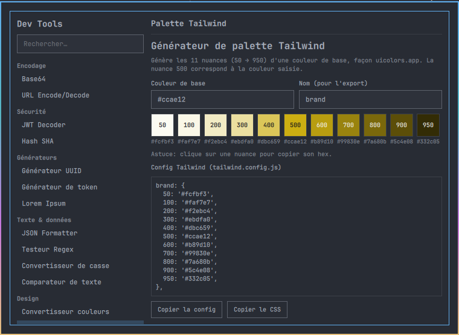

# Omarchy Dev Tools

Boîte à outils développeur façon [it-tools.tech](https://it-tools.tech), packagée comme
plugin [Omarchy](https://omarchy.org) : un **panneau natif QML** du shell Omarchy, ouvert
en un clic sur l'icône `</>` de la barre (toggle, `Échap` pour fermer).



- **Panneau natif** : QML/Quickshell comme les panels du shell, sans fenêtre navigateur.
- **Hors ligne** : les 15 outils de conversion, texte, crypto et design tournent en local,
  sans requête réseau.
- **Outils réseau** : vhosts locaux (`/etc/hosts` + nginx, HTTPS local) et exposition
  d'un port via ngrok, avec confirmation explicite avant toute action système.

## Outils

| Catégorie | Outils |
|---|---|
| Encodage | Base64, URL encode/decode |
| Sécurité | JWT decoder, Hash (SHA-1/256/384/512) |
| Générateurs | UUID v4, token / mot de passe (aléa `/dev/urandom`, sans biais), Lorem Ipsum |
| Texte & données | JSON formatter/minifier/validator, testeur regex, convertisseur de casse, comparateur de texte |
| Design | Convertisseur de couleurs (HEX/RGB/HSL), générateur de palette Tailwind (50→950) |
| Date & heure | Convertisseur timestamp Unix, explicateur d'expression cron |
| Réseau local | Gestionnaire de vhosts (`omarchy-vhost`), exposition via ngrok (`omarchy-ngrok`) |

## Dépendances

Obligatoires : **Omarchy** (shell Quattro + Hyprland). Les outils utilitaires utilisent
seulement `bash`, `od` et `sha*sum` (coreutils), déjà présents.

Optionnelles, uniquement pour les outils réseau :

- **nginx** : reverse proxy des vhosts. Sans lui, `omarchy-vhost` se limite à `/etc/hosts`.
- **mkcert** : certificats HTTPS locaux de confiance. Sans lui, un certificat autosigné
  est généré avec `openssl`.
- **ngrok** + un authtoken (compte gratuit sur [ngrok.com](https://ngrok.com)).
- **polkit** (`pkexec`) : création et suppression des vhosts depuis le panneau.
- **curl** : `omarchy-ngrok status`.
- **chromium** ou **google-chrome** : uniquement pour la version web de secours.

Quand nginx, mkcert ou ngrok manquent, le panneau propose de les installer. L'installation
ne démarre qu'après un clic sur **Installer** : elle s'ouvre dans un terminal
(`yay -S --needed …`), où vous voyez la commande et tapez vous-même le mot de passe.
`omarchy-vhost` demande de même une confirmation `[o/N]` avant `pacman -S nginx`.

## Installation

```bash
omarchy plugin add https://github.com/momostifler96/omarchy-dev-tools --enable
```

L'icône `</>` apparaît dans la barre. Pour la déplacer :
`omarchy bar move momoledev.dev-tools --section left|center|right`.

Les outils vhost et ngrok ont besoin des commandes `omarchy-vhost` et `omarchy-ngrok`
dans le `PATH`. Le script suivant les copie dans `~/.local/bin` sans rien modifier
d'autre :

```bash
~/.config/omarchy/plugins/momoledev.dev-tools/bin/install.sh
```

Raccourci clavier facultatif, à ajouter vous-même dans `~/.config/hypr/bindings.lua` :

```lua
o.bind("SUPER + SHIFT + T", "Omarchy Dev Tools", "omarchy-shell -q shell toggle momoledev.dev-tools")
```

Mise à jour : `omarchy plugin update momoledev.dev-tools`, puis relancez `bin/install.sh`
si vous l'aviez utilisé.

## Désinstallation

```bash
omarchy-vhost list                      # vhosts encore présents
sudo omarchy-vhost remove monapp.test   # pour chacun, si vous ne les gardez pas
~/.config/omarchy/plugins/momoledev.dev-tools/bin/uninstall.sh   # retire les CLI de ~/.local/bin
omarchy plugin remove momoledev.dev-tools
rm -f ~/.local/state/omarchy/dev-tools.json   # dernier outil ouvert
```

Retirez aussi la ligne `o.bind("SUPER + SHIFT + T", …)` de `bindings.lua` si vous l'aviez
ajoutée. Les paquets installés à votre demande (nginx, mkcert, ngrok) restent installés.

## Vhosts locaux

Depuis le panneau (outil **Gestionnaire de vhosts**) ou en ligne de commande :

```bash
sudo omarchy-vhost add monapp.test 3000            # /etc/hosts + reverse proxy nginx
sudo omarchy-vhost add monapp.test 3000 --no-nginx # /etc/hosts uniquement
sudo omarchy-vhost add monapp.test 3000 --https    # HTTPS local, 80 redirigé vers 443
omarchy-vhost list
sudo omarchy-vhost remove monapp.test              # hosts + nginx + certificat
```

`add` et `remove` écrivent dans des fichiers système et demandent donc les droits root :
`sudo` dans un terminal, ou la fenêtre de mot de passe polkit (`pkexec`) quand vous
cliquez sur **Créer le vhost** / **Supprimer** dans le panneau. Rien n'est exécuté en root
sans cette confirmation.

Ce que fait `add` :

- ajoute `127.0.0.1 <domaine>  # omarchy-vhost` à `/etc/hosts` ;
- écrit `/etc/nginx/sites-available/<domaine>.conf` (proxy vers `127.0.0.1:<port>`,
  WebSocket inclus), l'active dans `sites-enabled/`, vérifie `nginx -t` puis recharge ;
- avec `--https`, crée un certificat dans `/etc/omarchy-vhost/certs/<domaine>/`
  (dossier `0700`, clé `0600`).

`remove` ne retire que les entrées marquées `# omarchy-vhost` et les fichiers qu'il a créés.
Le domaine doit être un nom d'hôte en minuscules contenant un point (`monapp.test`) et le
port un entier de 1 à 65535. Toute autre valeur est refusée avant la moindre écriture.

## Exposition via ngrok

```bash
omarchy-ngrok 3000                                  # expose le port 3000
omarchy-ngrok 3000 --domain=mondomaine.ngrok-free.app
omarchy-ngrok status                                # tunnels actifs (API locale)
```

L'outil **Exposer via ngrok** enregistre l'authtoken avec `ngrok config add-authtoken`
(stocké par ngrok dans sa propre configuration) et affiche en direct les URL publiques
via l'API locale `http://127.0.0.1:4040`. Un tunnel ngrok rend le port accessible depuis
Internet : n'exposez que ce que vous voulez publier.

## Fichiers

| Chemin | Contenu |
|---|---|
| `~/.local/state/omarchy/dev-tools.json` | dernier outil ouvert |
| `~/.local/bin/omarchy-{dev-tools,vhost,ngrok}` | CLI, si `bin/install.sh` a été lancé |
| `/etc/hosts`, `/etc/nginx/sites-*/<domaine>.conf`, `/etc/omarchy-vhost/` | vhosts créés à votre demande |

## Dépannage

| Symptôme | Solution |
|---|---|
| L'icône `</>` n'apparaît pas | `omarchy plugin list \| grep dev-tools`, puis `omarchy plugin enable momoledev.dev-tools right` |
| « Action annulée ou pkexec indisponible » | Fenêtre polkit fermée, ou `omarchy-vhost` absent du `PATH` : lancez `bin/install.sh` |
| `omarchy-vhost: domaine invalide` | Utilisez un nom en minuscules avec un point, par exemple `monapp.test` |
| nginx n'est pas configuré | nginx absent ou installation refusée : `sudo pacman -S nginx`, puis recréez le vhost |
| Avertissement HTTPS dans le navigateur | Certificat autosigné : installez `mkcert`, lancez `mkcert -install`, puis `remove` + `add --https` |
| « Agent ngrok injoignable » | Lancez `omarchy-ngrok <port>` sur la même machine |
| Erreurs QML | `journalctl --user -f \| grep -i dev-tools` |

## Version web de secours

`src/index.html` est une page autonome qui reprend les outils utilitaires. La commande
`omarchy-dev-tools` l'ouvre dans Chromium/Chrome en mode application, ou via `xdg-open`.

## Structure

```
manifest.json      manifest du plugin Omarchy
Widget.qml         icône </> de la barre, toggle du panneau
Panel.qml          panneau : recherche, liste des outils, outil actif
Helpers.js         logique pure des outils
tools/*Tool.qml    un fichier par outil, plus les composants partagés
bin/               omarchy-vhost, omarchy-ngrok, omarchy-dev-tools, install.sh, uninstall.sh
src/index.html     version web de secours
```

Pour ajouter un outil : créez `tools/MonOutil.qml` (racine `ToolHeader`) et ajoutez
`{ id, name, category, file }` à `toolRegistry` dans `Panel.qml`. Vérifiez les scripts avec
`bash -n bin/*`.

## Licence

[MIT](LICENSE)
